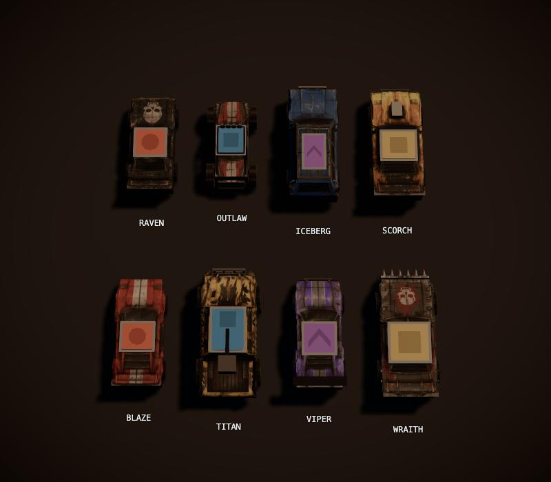

# Wreckline

Top-down combat racer in the browser, in the spirit of Death Rally (1996): race, shoot, drop mines, wreck your rivals, buy a better car.

**Play it: https://underscorelog.github.io/wreckline/**


| | |
|---|---|
|  |  |
| Neon Mile: dark tracks light up with headlight beams and lamp pools | Frostbite Pass: the pack on rocket fuel through the snow |
|  |  |
| 8 cars, each a 3D model; in a race a soft rim glow shows the driver's colour | Career shop: upgrades, supplies and cars |

## Features

- 8 cars from the RAVEN starter to the WRAITH of the boss, THE WARDEN, each with its own handling, armour and engine sound
- 10 tracks across 6 themes: desert, city at night, snow, quarry, docks and scrapyard
- Front gun with overheat, mines, rocket fuel boost, bumper spikes for ramming; pickups for cash, repairs, mines and fuel
- Career: pick easy, medium or hard races, earn prize money and points, repair damage that carries between races, upgrade or buy a new car, sabotage the leading rival, then beat THE WARDEN
- Quick race on any track
- AI drivers that follow a racing line, fight, avoid wrecks and use pickups
- Keyboard and gamepad, menus included
- Deterministic simulation: same seed and inputs, same race

## Controls

| Action | Keyboard | Gamepad |
|---|---|---|
| Throttle / brake | Up / Down | RT / LT |
| Steer | Left / Right | Left stick or D-pad |
| Fire | S | A |
| Drop mine | D | X |
| Rocket fuel | A | Y or RB |
| Handbrake | Space | B |
| Pause | Esc | Start |

## Technical overview

| Layer | Choice |
|---|---|
| Language and build | TypeScript 7.0, Vite 8.3, React 19.3 for menus and HUD |
| Rendering | three.js 0.186 (WebGL), postprocessing 6.39 (bloom, motion blur at the screen edges) |
| Physics | Rapier 2D 0.21, deterministic-compat build (WASM) |
| Audio | Web Audio API: per-car synth engines, recorded engine loops crossfaded by rpm and load, mixed sample effects |
| Tests | Vitest 5.0 |
| Hosting | GitHub Pages, deployed by GitHub Actions on every push to `main` |

- **Pure simulation.** `src/sim` runs at a fixed 60 Hz with a seeded RNG and Rapier's deterministic build. It has no DOM and no clock, so the same seed and inputs always give the same race, and races run headless in Node for tests, AI soak runs and the balance probes in `scripts/balance/`.
- **Module boundaries.** `src/sim`, `src/shared`, `src/content` and `src/meta` never import three.js, React or the DOM. Render, audio and UI only read snapshots. `npm run check:boundaries` enforces this.
- **Frame loop.** Input is polled once per frame, the sim steps up to 5 times, then the renderer interpolates between the last two snapshots. Audio and the HUD (15 Hz) read the same snapshots and the sim's event list.
- **Car models.** Modelled in Blender from concept sheets, then imported by `scripts/assets/importCars.mjs`: glTF-Transform and meshoptimizer's simplifier (about 1900-2300 triangles per car), textures resized and converted to WebP with sharp. All 8 cars are 1.36 MB together.
- **Tracks.** Built from data: a centreline, width, props and pickups per track in `src/content/tracks/`, with theme dressing done at render time.
- **Engine sound.** Each car has a synth voice (fake gearbox, sub-octave, filtered exhaust noise, idle wobble, supercharger whine). BLAZE, ICEBERG and TITAN instead play CC0 recordings cut into rpm and load loops by `scripts/sfx/importEngines.mjs`.
- **Budgets.** 60 fps at 1920x1080, under 150 draw calls, under 2.5 MB gzip in total (about 1.86 MB now, Rapier's WASM included). `npm run build` fails over the size budget.
- **Spec-driven.** `SPEC.md` is the build spec. `specs/` holds the contracts, content tables, art direction and one file per work package. `docs/tuning-log.md` records every tuned value and why it changed.

### Source layout

```
src/
  shared/    contracts, seeded RNG, math, track geometry   (pure TS)
  content/   cars, tracks, AI, economy, rivals              (pure data)
  sim/       vehicles, race rules, combat, AI drivers       (pure TS + Rapier)
  meta/      career, shop, save                             (pure TS)
  render/    scene, camera, cars, tracks, effects           (three.js)
  audio/     engines, samples, mix bus                      (Web Audio)
  input/     keyboard, gamepad
  ui/        screens, HUD, components                       (React)
  game/      main loop, state machine, wiring
```

## Credits

- Sound effects: Pixabay, under the Pixabay Content License. Engine recordings: Freesound, CC0. Sources in `docs/sfx-sources.md`.
- Fonts: Chakra Petch and Inter via Fontsource.

## Run

```sh
npm ci            # Node 22, exact versions from package-lock.json
npm run dev       # Vite dev server on http://localhost:5181 (strictPort)
npm run verify    # typecheck + check:boundaries + test + build (with bundle size check)
```

Other scripts: `npm test` (Vitest, Node), `npm run typecheck`, `npm run build` (prints gzip sizes, fails over 2.5 MB),
`npm run check:boundaries` (module rules of SPEC.md section 3; `-- --self-test` checks the checker).

## Query params

| Param | Effect |
|---|---|
| `?harness=render\|ui\|audio\|input` | Mount that WP's dev harness instead of the game |
| `?screen=<Screen>` | With `harness=ui`: open that screen with fixture data |
| `?race=1&seed=N&laps=N&ai=N&track=id` | Skip menus, start a quick race directly |
| `?autoplay=1` | Player car driven by a medium AI (for unattended checks) |
| `?fps=1` | FPS / draw-call overlay |
| `?autopause=0` | Disable auto-pause on blur/hidden (scripted checks in a hidden browser pane) |
| `?harness=debug2d[&fake=1]` | WP00 2D debug view; also reads `seed`, `laps`, `ai` (AI opponents, default 3), `autoplay`, `track` |

The debug view exposes `window.__harness = { sim, step(n), snapshot(), setInput(partial), clearInput(), finishRace() }`.
It steps in real time only while the page is visible and focused (unless `autopause=0`); the first `step(n)` call switches it to scripted mode for good.
