# Wreckline

Top-down combat racer in the browser, in the spirit of Death Rally (1996): race, shoot, drop mines, wreck your rivals, buy a better car, and win your family's garage back from THE WARDEN. Between careers: a last-car-standing arena and time trials against your own ghost.

**Play it: https://underscorelog.github.io/wreckline/**

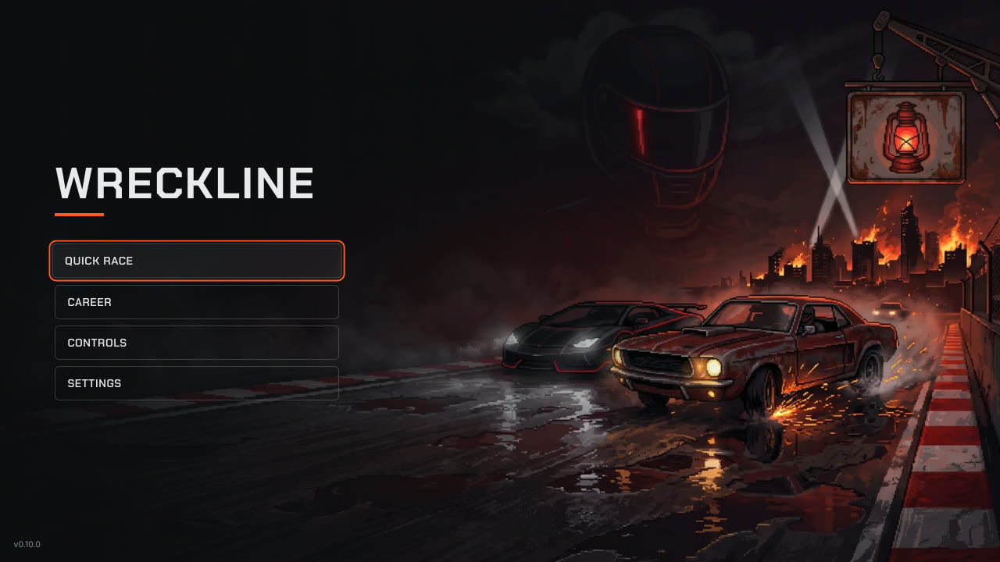

| | |
|---|---|
| 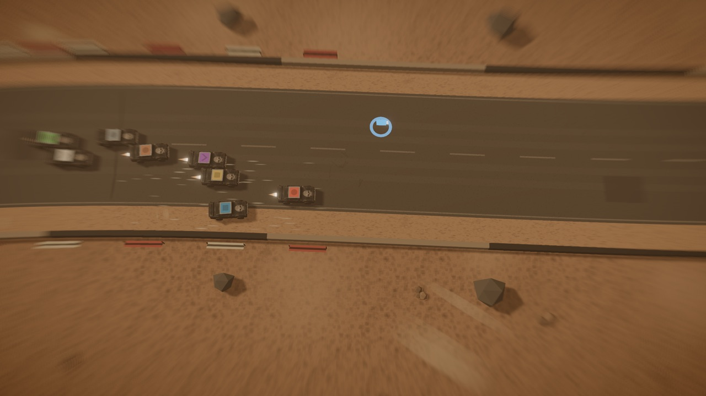 | 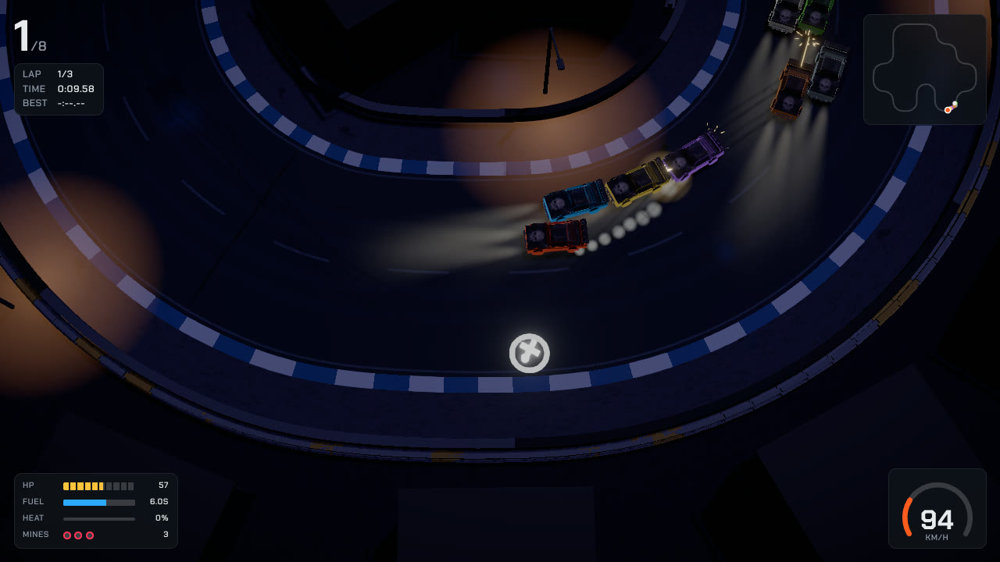 |
| Dust Bowl: the pack fights through a chain of desert bends | Neon Mile at night: the pack bunched up round a city-block corner |
| 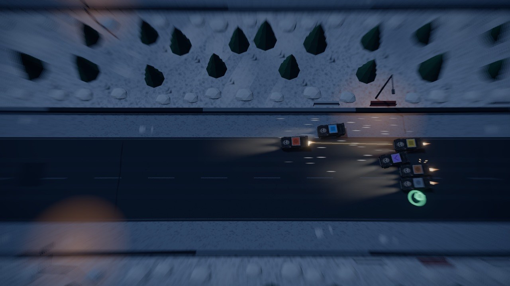 | 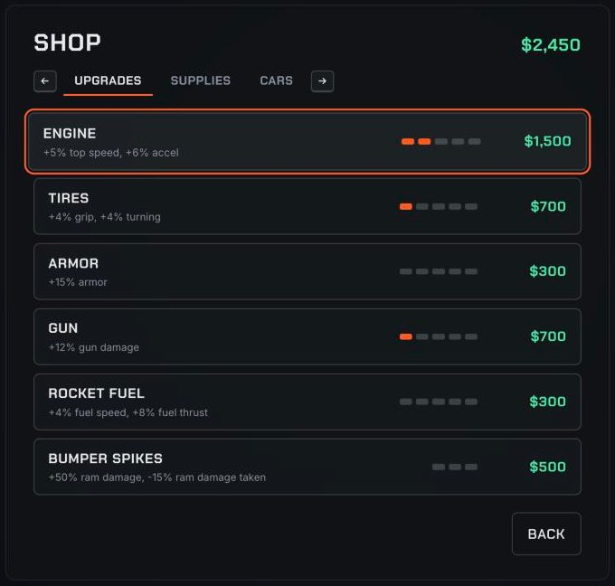 |
| Frostbite Pass: the pack through the snow switchbacks | Career shop: upgrades, supplies and cars |
| 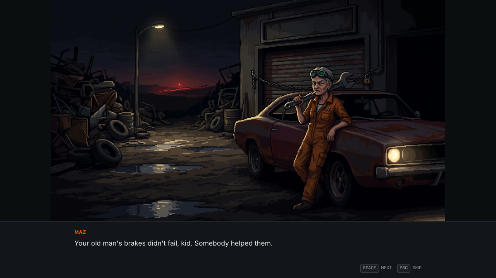 | 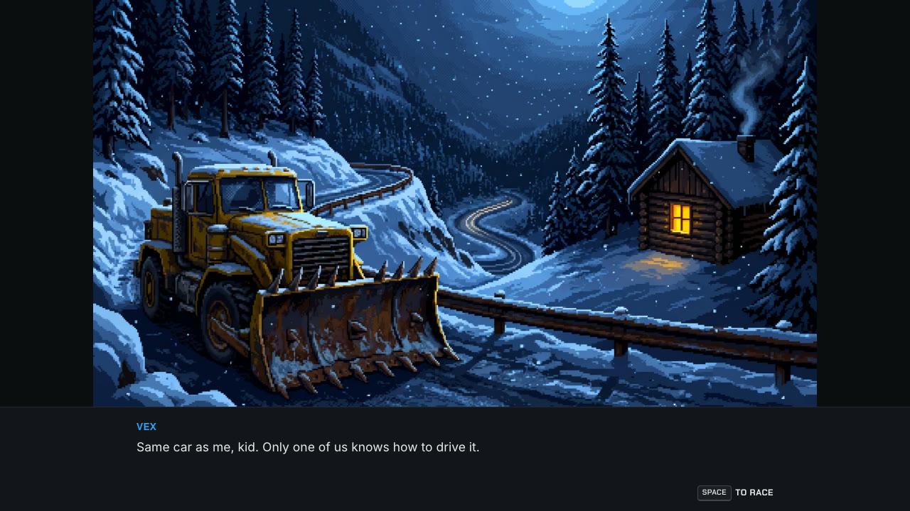 |
| The story: MAZ, the family mechanic, and the garage THE WARDEN took | Before every career race: a track scene, with taunts from the rivals in it |
| 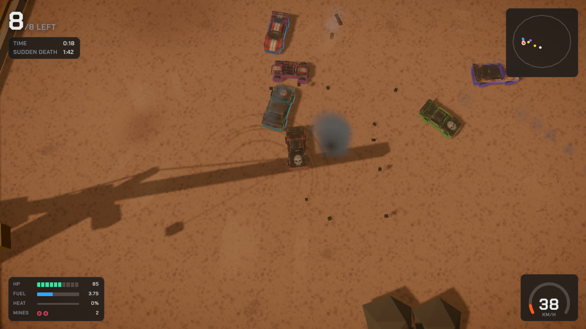 | 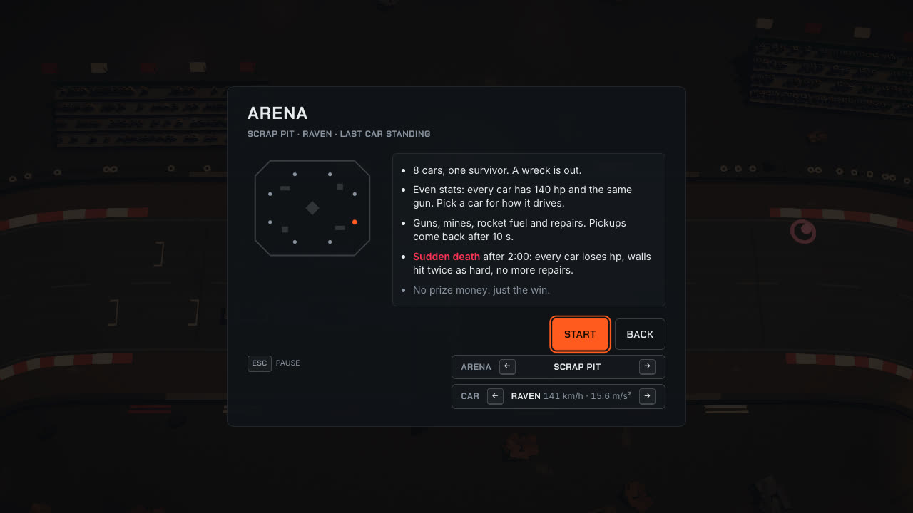 |
| Arena, Quarry Bowl: eight cars, one survivor | Arena setup: even stats, sudden death after 2:00 |
| 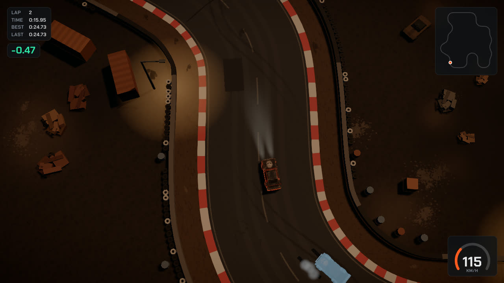 | 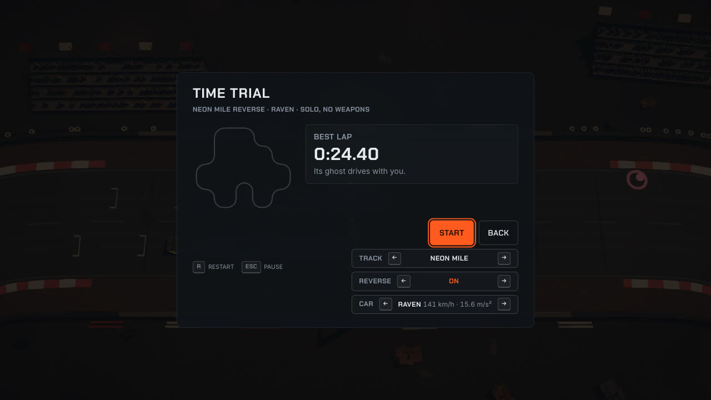 |
| Time trial: the ghost of your best lap behind you, the live gap in green | Time trial setup: Neon Mile reversed, best lap saved per track, direction and car |

## Features

- 8 cars from the RAVEN starter to the WRAITH of the boss, THE WARDEN, each with its own handling, armour and engine sound
- 10 tight Death Rally style tracks (a chain of short bends and hairpins, 22-27 s laps) across 6 themes: desert, city at night, snow, quarry, docks and scrapyard, each raceable in reverse with its own start line
- Front gun with overheat, mines, rocket fuel boost, bumper spikes for ramming; pickups for cash, repairs, mines and fuel
- Career: pick easy, medium or hard races on three different tracks each round, earn prize money and points, repair damage that carries between races, upgrade or buy a new car, sabotage the leading rival, then beat THE WARDEN
- Story: THE WARDEN took the family's Red Lantern Garage; six painted story scenes at rank milestones and a scene for every track before each career race, with typed-out dialogue (MAZ the mechanic, four rival lieutenants, THE WARDEN); SPACE goes on, ESC skips
- Beat a car in a career race to unlock it in the shop; quick race on any track, either direction, with any of the 8 cars
- Arena: 8 cars in a closed arena (Scrap Pit, Quarry Bowl, Dock Lot), last car standing wins; every car gets the same health and gun, and sudden death from 2:00 makes sure every fight ends
- Time trial: alone on any track and direction with any car, racing the ghost of your best lap with a live delta; R or Select restarts instantly; best laps and ghosts saved per track, direction and car
- Difficulty: EASY / NORMAL / HARD in Settings, for every AI in quick race, career and arena, with the same rewards
- Background music: six race tracks and a menu track, mixed under the engines and guns, with its own volume slider
- AI drivers that follow a racing line, fight, avoid wrecks and use pickups; on NORMAL the best of them laps at a good human's pace in the same car
- Keyboard and gamepad, menus included
- Deterministic simulation: same seed and inputs, same race

## Controls

| Action | Keyboard | Gamepad |
|---|---|---|
| Throttle / brake | Up / Down | RT / LT |
| Steer | Left / Right | Left stick or D-pad |
| Fire | S | A |
| Drop mine | D | X |
| Rocket fuel | A | Y or RB |
| Handbrake | Space | B |
| Pause | Esc | Start |
| Restart (time trial) | R | Select |

## Technical overview

| Layer | Choice |
|---|---|
| Language and build | TypeScript 7.0, Vite 8.3, React 19.3 for menus and HUD |
| Rendering | three.js 0.186 (WebGL), postprocessing 6.39 (bloom, motion blur at the screen edges) |
| Physics | Rapier 2D 0.21, deterministic-compat build (WASM) |
| Audio | Web Audio API: per-car synth engines, recorded engine loops crossfaded by rpm and load, mixed sample effects, streamed Ogg Opus music on its own bus |
| Tests | Vitest 5.0 |
| Hosting | GitHub Pages, deployed by GitHub Actions on every push to `main` |

- **Pure simulation.** `src/sim` runs at a fixed 60 Hz with a seeded RNG and Rapier's deterministic build. It has no DOM and no clock, so the same seed and inputs always give the same race, and races run headless in Node for tests, AI soak runs and the balance probes in `scripts/balance/`.
- **Module boundaries.** `src/sim`, `src/shared`, `src/content` and `src/meta` never import three.js, React or the DOM. Render, audio and UI only read snapshots. `npm run check:boundaries` enforces this.
- **Frame loop.** Input is polled once per frame, the sim steps up to 5 times, then the renderer interpolates between the last two snapshots. Audio and the HUD (15 Hz) read the same snapshots and the sim's event list.
- **Car models.** Modelled in Blender from concept sheets, then imported by `scripts/assets/importCars.mjs`: glTF-Transform and meshoptimizer's simplifier (about 1900-2300 triangles per car), textures resized and converted to WebP with sharp. All 8 cars are 1.36 MB together.
- **Tracks.** Built from data: a corner list rounded into a centreline, width, props and pickups per track in `src/content/tracks/`, with theme dressing done at render time. A shape metric (`trackShape`) and a test keep every track "Death Rally tight": at most 25% near-straight, no straight over 80 m, at least 10 corners. Reversed layouts (`<id>~r`) are built from the same data at load by `src/content/tracks/reverse.ts`, with the start moved onto a straight.
- **Arena.** An arena is data too (`src/content/arenas/`): a convex outer wall plus solid blocks, carried by a TrackDef so the same collider and dressing code builds it. The arena rules (elimination order, sudden death, pickup respawn) and the AI's target picking live in their own sim files; racing behaviour is unchanged, which the balance probes check.
- **Ghost.** The time trial records the car's pose at 20 Hz, quantised and delta-encoded to about 2 kB per lap in `localStorage`, and replays it interpolated to the frame.
- **Story.** Lines and triggers are data (`src/content/story.ts`, written in `specs/story.md`); `src/meta/story.ts` picks the scene from the save and the race offer with no randomness. The 17 painted frames were generated with Google Gemini from the prompts in `specs/story-art-prompts.md` and converted to WebP by `scripts/assets/importStory.mjs`.
- **Music.** `scripts/sfx/importMusic.mjs` cuts each CC0 track to a seamless loop, normalises it with a BS.1770 loudness meter and encodes Opus; at default volume the music sits about 12 LU under the race sound.
- **Engine sound.** Each car has a synth voice (fake gearbox, sub-octave, filtered exhaust noise, idle wobble, supercharger whine). BLAZE, ICEBERG and TITAN instead play CC0 recordings cut into rpm and load loops by `scripts/sfx/importEngines.mjs`.
- **Budgets.** 60 fps at 1920x1080, under 150 draw calls, under 2.5 MB gzip in total (about 1.88 MB now, Rapier's WASM included; music and story images stream from `public/` on demand). `npm run build` fails over the size budget.
- **Spec-driven.** `SPEC.md` is the build spec. `specs/` holds the contracts, content tables, art direction and one file per work package. `docs/tuning-log.md` records every tuned value and why it changed.

### Source layout

```
src/
  shared/    contracts, seeded RNG, math, track geometry   (pure TS)
  content/   cars, tracks, arenas, AI, economy, rivals      (pure data)
  sim/       vehicles, race rules, combat, AI drivers       (pure TS + Rapier)
  meta/      career, shop, save                             (pure TS)
  render/    scene, camera, cars, tracks, effects           (three.js)
  audio/     engines, samples, mix bus                      (Web Audio)
  input/     keyboard, gamepad
  ui/        screens, HUD, components                       (React)
  game/      main loop, state machine, wiring
```

## Credits

- Sound effects: Pixabay, under the Pixabay Content License. Engine recordings: Freesound, CC0. Sources in `docs/sfx-sources.md`.
- Music: OpenGameArt, CC0, by MintoDog, Alexander Ehlers (tricksntraps), cynicmusic, Kistol and Sudocolon. Sources in `docs/sfx-sources.md`.
- Story and title art: generated with Google Gemini from our own prompts (`specs/story-art-prompts.md`).
- Fonts: Chakra Petch and Inter via Fontsource.

## Run

```sh
npm ci            # Node 22, exact versions from package-lock.json
npm run dev       # Vite dev server on http://localhost:5181 (strictPort)
npm run verify    # typecheck + check:boundaries + test + build (with bundle size check)
```

Other scripts: `npm test` (Vitest, Node), `npm run typecheck`, `npm run build` (prints gzip sizes, fails over 2.5 MB),
`npm run check:boundaries` (module rules of SPEC.md section 3; `-- --self-test` checks the checker).

## Query params

| Param | Effect |
|---|---|
| `?harness=render\|ui\|audio\|input` | Mount that WP's dev harness instead of the game |
| `?screen=<Screen>` | With `harness=ui`: open that screen with fixture data |
| `?race=1&seed=N&laps=N&ai=N&track=id` | Skip menus, start a quick race directly |
| `?autoplay=1` | Player car driven by a medium AI (for unattended checks) |
| `?fps=1` | FPS / draw-call overlay |
| `?autopause=0` | Disable auto-pause on blur/hidden (scripted checks in a hidden browser pane) |
| `?harness=debug2d[&fake=1]` | WP00 2D debug view; also reads `seed`, `laps`, `ai` (AI opponents, default 3), `autoplay`, `track` |

The debug view exposes `window.__harness = { sim, step(n), snapshot(), setInput(partial), clearInput(), finishRace() }`.
It steps in real time only while the page is visible and focused (unless `autopause=0`); the first `step(n)` call switches it to scripted mode for good.
